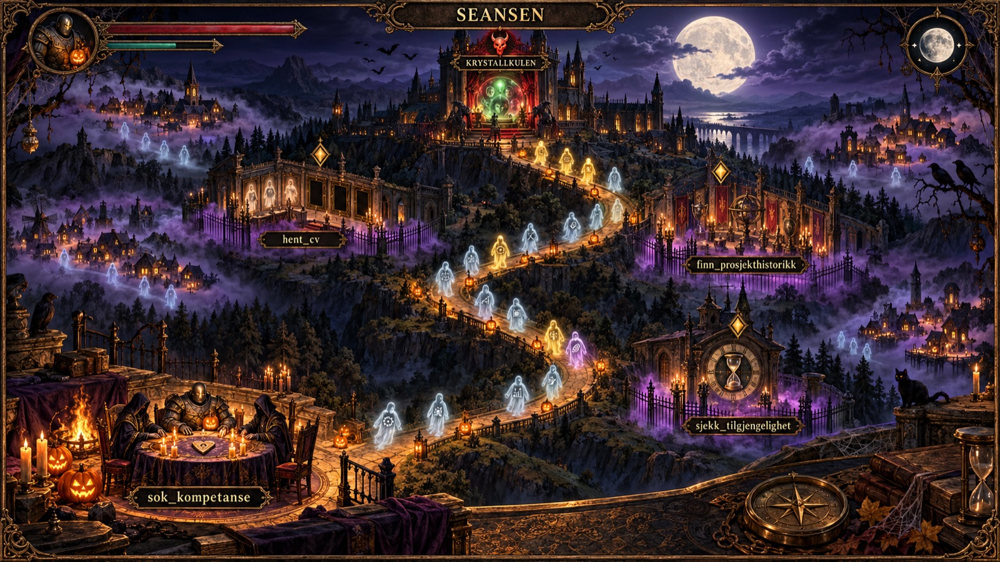

# Seansen 🔮



Bygg en agent som svarer på «hvem kan ta denne jobben?» ved å lete i kompetanse-, tilgjengelighets- og CV-data for 80 oppdiktede konsulenter.

## Kom i gang

```bash
npm install
cp .env.example .env        # lim inn API-nøkkelen
npm start                   # kjører eksempelbehovet
npm start -- "Vi trenger en React-utvikler i Bergen fra desember"
```

Krever Node 20.12 eller nyere.

## Hva ligger her

| Fil | Hva |
|---|---|
| `src/agent.js` | Agentløkka: spør modellen, kjør verktøy, send svar tilbake, gjenta. |
| `src/verktoy.js` | Systemprompt, eksempelbehov og verktøyene. Her jobber dere. |
| `src/index.js` | Startpunkt for `npm start`. |
| `data/konsulenter.json` | Profiler: grad, rolle, avdeling, lokasjon, kompetanse (nivå 1–5), sertifiseringer, språk. |
| `data/tilgjengelighet.json` | Nåværende oppdrag, ledig fra-dato og ledig prosent per konsulent. |
| `data/prosjekthistorikk.json` | Tidligere prosjekter: kunde, bransje, år, rolle, teknologier. |
| `data/cv/<id>.md` | Korte CV-sammendrag. Bare rundt 20 har CV. |

Kun `sok_kompetanse` er implementert. `sjekk_tilgjengelighet`, `hent_cv` og `finn_prosjekthistorikk` er stubber med ferdig beskrivelse. All data er syntetisk, og den er ikke helt ryddig: CV og profil sier ikke alltid det samme.

**Grad:** Vi antar at A er graduate/junior og E er mest senior (A, B, C, D, E i stigende ansiennitet). Stemmer ikke det med deres virkelighet, rett det i `system` i `src/verktoy.js` og i verktøybeskrivelsen.

## Legg til et verktøy

Finn stubben i `src/verktoy.js` og bytt ut `kjør: null` med en funksjon. Den sendes til modellen fra neste kjøring.

```js
const tilgjengelighet = lesJson('tilgjengelighet.json');

// i sjekk_tilgjengelighet:
kjør: async ({ ider }) => {
  if (!ider?.length) throw new Error('Oppgi minst én id.');
  return tilgjengelighet.filter((t) => ider.includes(t.id));
},
```

Kaster funksjonen en feil, får modellen meldingen tilbake som et feilresultat og kan prøve på nytt. Beskrivelsen er det modellen leser for å forstå verktøyet, så skriv den som til en ny kollega.

## Hvis du ikke bruker JavaScript

Dataene er ren JSON og markdown. Ta med `data/`-mappa og bygg løkka i det språket dere vil. `src/agent.js` er rundt 80 linjer og viser hele mønsteret.

## Tips

- MVP er to verktøy og én løkke. `sok_kompetanse` og `sjekk_tilgjengelighet` holder til en god demo.
- Vis verktøykallene i demoen. Det er der publikum ser at agenten faktisk jobber.
- `MAX_ITERASJONER` i `.env` stopper en agent som går i ring (standard 10).
- `.env` committes aldri. Den står i `.gitignore`, la den bli der.

## Lagt til

- `sjekk_tilgjengelighet`: ledig fra-dato, prosent og nåværende oppdrag for en liste id-er. Ukjente id-er listes separat.
- `hent_cv`: henter CV-en som markdown. Id-en valideres, og mangler CV-en, får modellen beskjed om det.
- `finn_prosjekthistorikk`: tidligere prosjekter for én konsulent, nyeste først. Gir egen beskjed hvis historikk mangler.
- Systemprompt: henter CV og prosjekthistorikk for toppkandidatene, og svarer uten å stille oppfølgingsspørsmål.
